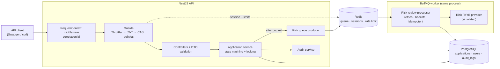
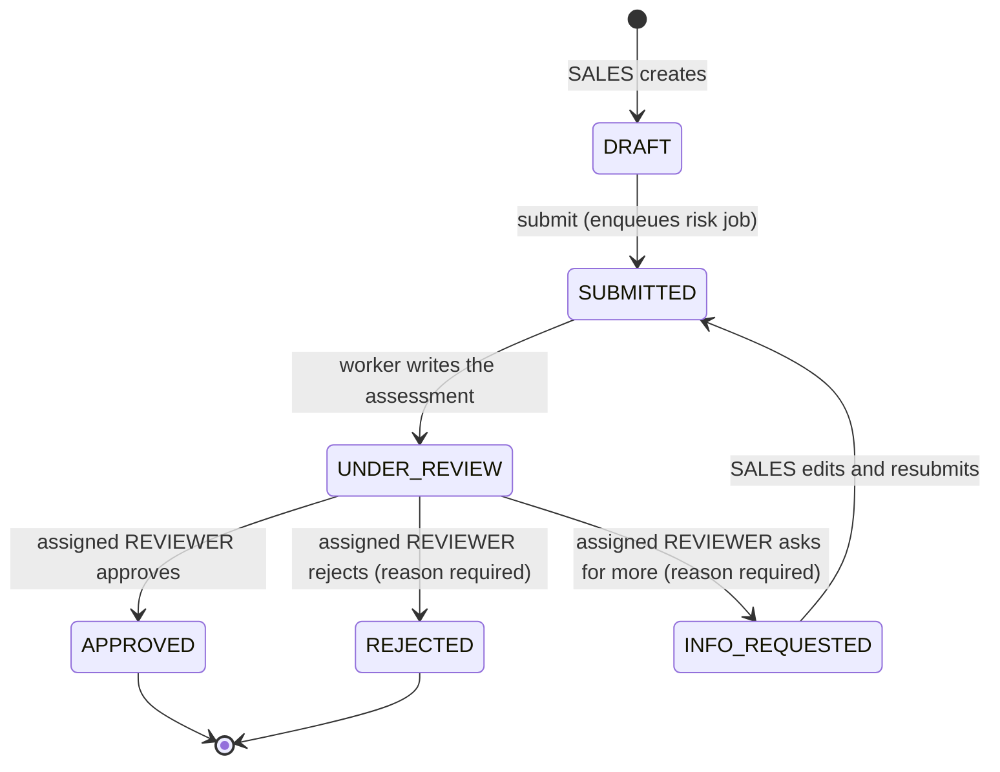
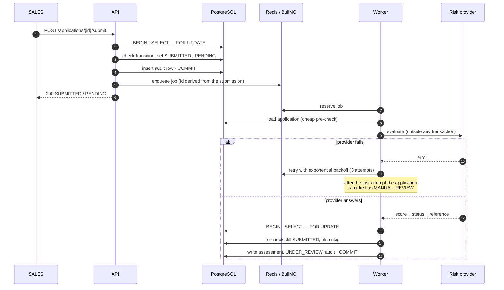
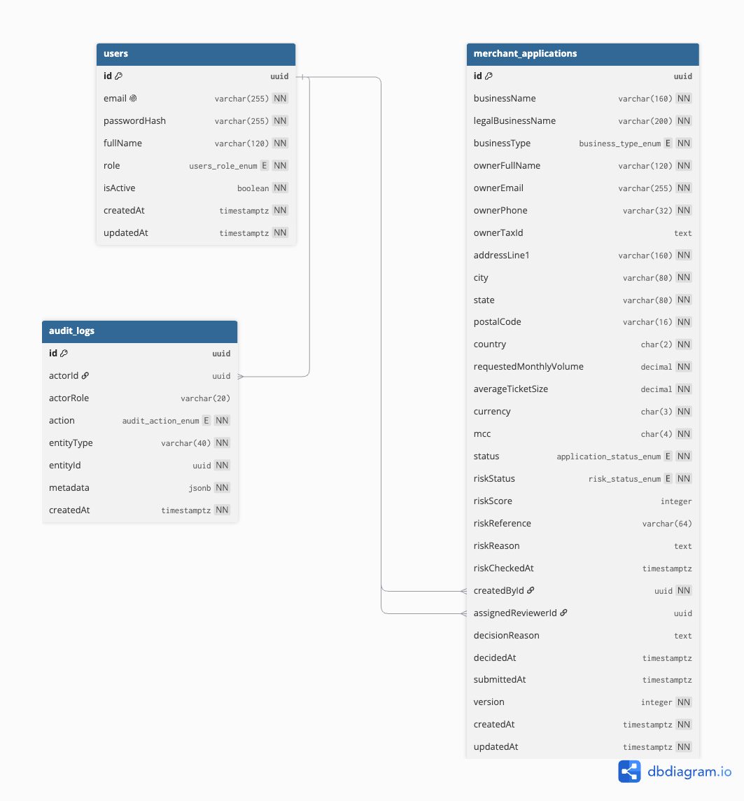

# Assignment: Merchant Onboarding & Operations API

This is my implementation of the Senior Backend Engineer assignment. The brief
asked for a production-oriented slice. From the requirements: a merchant payments
onboarding service where sales staff submit merchant applications, a background
worker scores them against a risk provider, and an assigned reviewer approves or
rejects them. Every significant action is written to an audit trail, and the whole
lifecycle is protected by object-level authorization.

Note: an AI coding assistant, Claude, was used throughout, following proper
security practices. Every change was run and verified locally before being
committed. I have included all the skills I used to do the assignment.

**Roles**

| Role       | Can do                                                                   |
| ---------- | ------------------------------------------------------------------------ |
| `SALES`    | Create, edit and submit applications — only the ones they created        |
| `REVIEWER` | Read the queue, and decide on applications **assigned to them**          |
| `ADMIN`    | Full operational access and reviewer assignment; cannot record decisions |

---

## Tech stack

| Choice                     | Why                                                                                                                                                                                  |
| -------------------------- | ------------------------------------------------------------------------------------------------------------------------------------------------------------------------------------ |
| **NestJS 11 + TypeScript** | Modules, DI and decorators keep guards, pipes and interceptors declarative.                                                                                                          |
| **PostgreSQL + TypeORM**   | Relational data with real constraints and transactions.                                                                                                                              |
| **Redis + BullMQ**         | Risk review must survive a slow provider, so it runs out-of-band with retries, exponential backoff and a dead-letter path. Redis also backs refresh-token sessions and rate limiting |
| **CASL**                   | Role _and_ object-level rules live in one ability factory.                                                                                                                           |
| **JWT**                    | Short-lived access tokens, single-use refresh tokens                                                                                                                                 |
| **Swagger**                | The API documents itself at `/docs`, with bearer auth wired in                                                                                                                       |
| **Jest + Supertest**       | Unit and integration tests against real Postgres and Redis                                                                                                                           |
| **Docker Compose**         | One command brings up Postgres, Redis and the API, already migrated and seeded                                                                                                       |

---

## System architecture



Two things in that picture are deliberate:

- The job is **enqueued after the database transaction commits**, so the worker
  can never read a row that does not exist yet.
- The provider call happens **outside** the transaction. It is the slowest step,
  and holding a row lock across it would exhaust the connection pool under load.

---

## Application lifecycle



Anything not drawn above is rejected with `409 Conflict`. Applications are
editable only in `DRAFT` and `INFO_REQUESTED`.

### Submit and risk review, end to end



Idempotency has two layers: the job id is derived from the submission, so a
duplicate enqueue is dropped by BullMQ; and the worker re-checks the status
under a row lock, so a replayed or concurrent job writes nothing.

---

## Data model



> Rendered from [`docs/schema.dbml`](docs/schema.dbml) — paste that file into
> [dbdiagram.io](https://dbdiagram.io/d) to regenerate it.

### Why these three tables

| Table                   | Holds                                  | Why it exists                                                                                                                                                                                                                   |
| ----------------------- | -------------------------------------- | ------------------------------------------------------------------------------------------------------------------------------------------------------------------------------------------------------------------------------- |
| `users`                 | Credentials, role, active flag         | Authentication and the role each ability is derived from. `passwordHash` is `select: false`, so a plain `find()` cannot leak it                                                                                                 |
| `merchant_applications` | The application and its current state  | One row per application, carrying both lifecycle state (`status`) and risk outcome (`riskStatus`). Keeping them as separate columns means an application can be `UNDER_REVIEW` while risk `FAILED` — the reviewer still decides |
| `audit_logs`            | Who did what, when, with which payload | Append-only history, written in the same transaction as the action. Generic `entityType`/`entityId` so other entities can be recorded later without a new table                                                                 |

### Columns worth explaining

The brief did not explicitly define a data model, so these fields are my own
assumption of what is needed.

| Column                                        | Type                 | Why                                                                                                                        |
| --------------------------------------------- | -------------------- | -------------------------------------------------------------------------------------------------------------------------- |
| `status`                                      | enum                 | Lifecycle position. An enum, not free text, so an invalid state cannot be written even by a direct SQL statement           |
| `riskStatus`                                  | enum                 | Kept apart from `status`: the machine's opinion versus the human's decision                                                |
| `ownerTaxId`                                  | `text`               | AES-256-GCM ciphertext written by a TypeORM transformer. Never returned — responses expose `ownerTaxIdMasked` only         |
| `requestedMonthlyVolume`, `averageTicketSize` | `numeric(14,2)`      | Money. Sent and returned as decimal **strings** and compared as integer minor units, so it never passes through a JS float |
| `createdById`                                 | FK → users           | The owner. SALES isolation is this column compared against the caller                                                      |
| `assignedReviewerId`                          | FK → users, nullable | Only this reviewer may decide. Null until an ADMIN assigns                                                                 |
| `riskReference`                               | varchar              | The provider's reference, kept for reconciliation and support                                                              |
| `version`                                     | integer              | Incremented on every write; useful when reconstructing what a row looked like                                              |
| `metadata` (audit)                            | `jsonb`              | Action-specific payload, passed through the same redaction as the logs before it is stored                                 |

Indexes cover the columns the API actually filters on: `status`, `riskStatus`,
`createdById`, `assignedReviewerId`, and `(entityType, entityId)` for the trail.

---

## Running it

Requirements: Docker and Docker Compose. Node 22 is only needed to run the tests
on the host.

```bash
make up
```

That generates `.env` with fresh secrets if it does not exist, builds the image,
starts Postgres, Redis and the API, then runs migrations and the seed.

|            |                                          |
| ---------- | ---------------------------------------- |
| Swagger UI | <http://localhost:3000/docs>             |
| API base   | <http://localhost:3000/api/v1>           |
| Readiness  | <http://localhost:3000/api/health/ready> |
| Liveness   | <http://localhost:3000/api/health/live>  |

Seeded accounts, all with the password `ChangeMe123!`:

| Email                                               | Role     |
| --------------------------------------------------- | -------- |
| `admin@merchant.test`                               | ADMIN    |
| `reviewer@merchant.test`, `reviewer2@merchant.test` | REVIEWER |
| `sales@merchant.test`, `sales2@merchant.test`       | SALES    |

Other targets:

```bash
make logs   # follow the API logs
make down   # stop everything and drop the volumes
```

> If ports 5432 or 6379 are already in use, change `DB_PORT` / `REDIS_PORT` in
> `.env` and run `make up` again.

### Trying it from Swagger

1. `POST /api/v1/auth/login` with one of the accounts above, copy `accessToken`.
2. Click **Authorize** and paste it.
3. `POST /api/v1/applications` as SALES, then `POST /{id}/submit`.
4. `GET /{id}` — within a second `riskStatus` moves off `PENDING`.
5. As ADMIN `POST /{id}/assign`, then as that reviewer `POST /{id}/decision`.

---

## Running the tests

```bash
make test
```

Starts Postgres and Redis if needed, installs dependencies, then runs both
suites. They can also be run individually:

```bash
npm run test       # unit — business rules, abilities, redaction, encryption
npm run test:e2e   # integration — HTTP through to Postgres, Redis and the worker
```

Integration tests create and migrate their **own** database (`merchant_test`)
and use a separate Redis database, so a running stack is never touched.

| Suite                                  | Covers                                                                                                                                                      |
| -------------------------------------- | ----------------------------------------------------------------------------------------------------------------------------------------------------------- |
| `auth.e2e-spec`                        | Login, identical failures for bad password and unknown email, refresh rotation, replay revoking every session, logout, rate limiting, correlation ids       |
| `authorization.e2e-spec`               | A SALES user cannot read, change, submit, list or audit another user's application; only the assigned reviewer can decide; ADMIN cannot stand in            |
| `applications.e2e-spec`                | Full lifecycle, invalid transitions, editability window, filtering and pagination, concurrent submits and decisions, exact decimal money                    |
| `risk.e2e-spec`, `risk-retry.e2e-spec` | Two workers racing on one application, retry and backoff against a real BullMQ worker, exhausted attempts parking as `MANUAL_REVIEW`, duplicate job dropped |

The authorization and concurrency tests were checked by deliberately removing the
protection and confirming they fail.

---

## Trade-offs and what is deliberately absent

- **404 instead of 403** when a SALES user requests another user's application,
  so the API does not confirm that an id exists.
- **Pessimistic row locks** on writes rather than optimistic retries: the audit
  row is written in the same transaction and needs the prior values.
- **A reviewer is assigned by id.** There is no user-directory endpoint; it was
  not in the brief.
- **The risk provider is simulated** but deterministic per application, so tests
  and repeated runs agree.
- **Encryption keys live in the environment.** A real deployment would use a KMS;
  the `v1:` prefix on every ciphertext is the hook for rotation.
- Webhook callbacks, MongoDB audit storage and a separate ADR were listed as
  optional in the brief and are not implemented.
